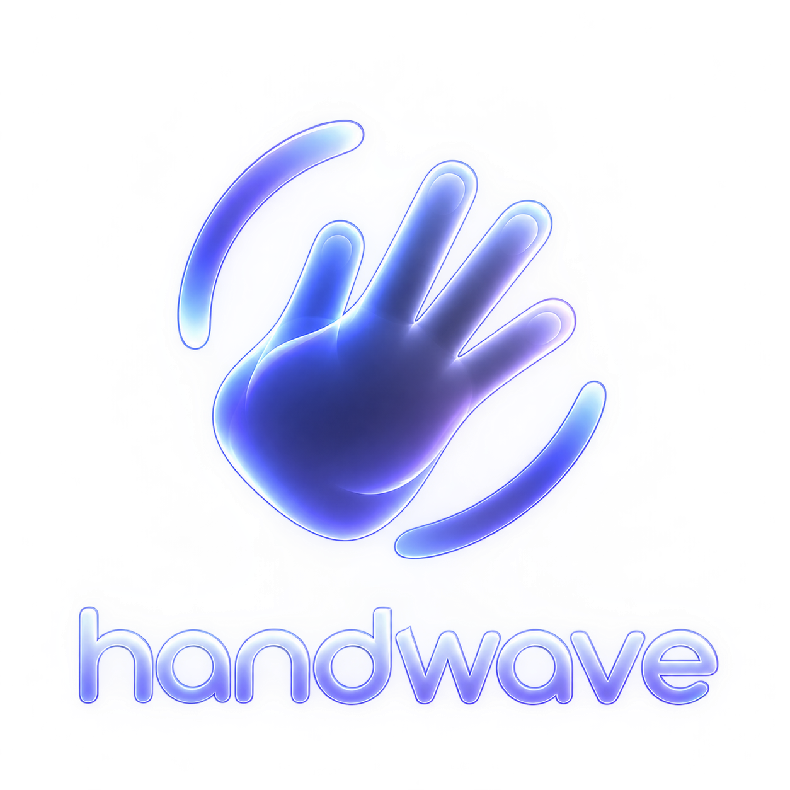
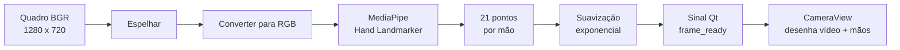
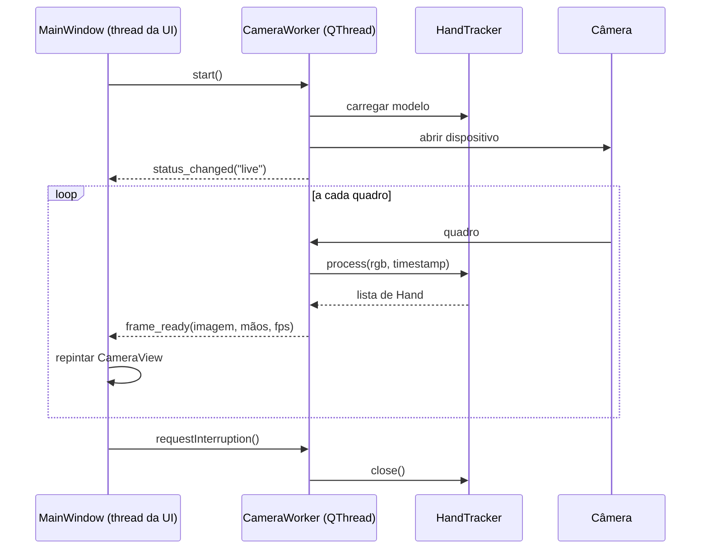
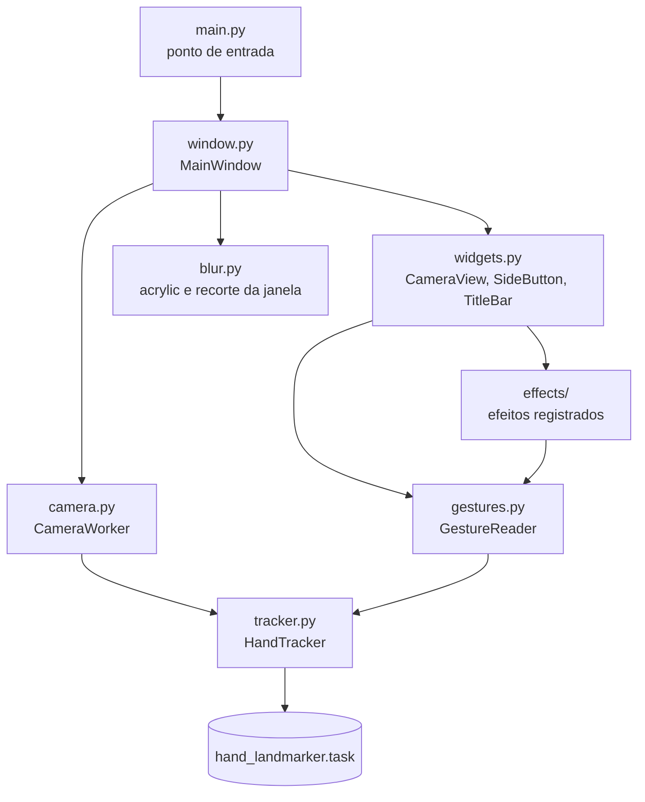
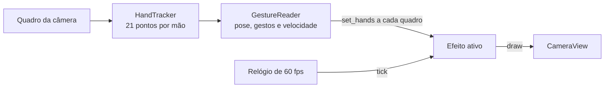
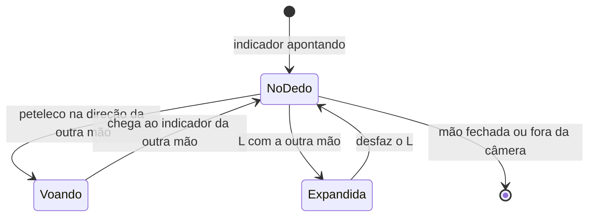
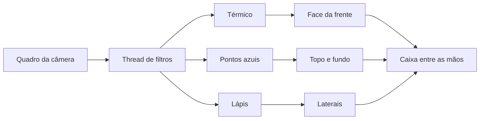
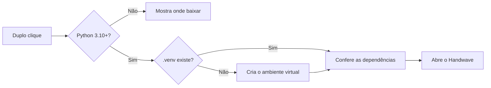
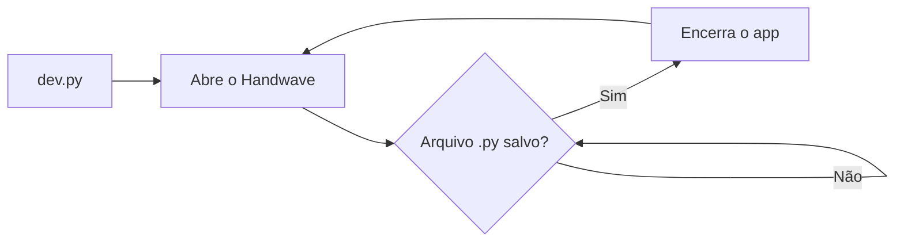
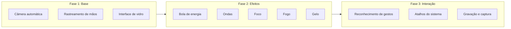

<div align="center">



# Handwave

**Controle e efeitos visuais em tempo real a partir do movimento das suas mãos.**

Uma aplicação desktop em Python que conecta a câmera automaticamente, rastreia as mãos com visão computacional e desenha tudo dentro de uma interface de vidro inspirada no macOS.

<br>


</div>

---

## Sumário

- [Visão geral](#visão-geral)
- [Recursos](#recursos)
- [Como funciona](#como-funciona)
- [Arquitetura](#arquitetura)
- [Instalação](#instalação)
- [Uso](#uso)
- [Estrutura do projeto](#estrutura-do-projeto)
- [Design](#design)
- [Roadmap e ideias](#roadmap-e-ideias)

---

## Visão geral

O Handwave transforma a webcam em uma superfície de interação. Assim que o app abre, ele procura uma câmera disponível, inicia o rastreamento e desenha o esqueleto de cada mão por cima do vídeo, com 21 pontos por mão. Isso serve de base para efeitos visuais e, mais à frente, para controle por gestos.

| | Destaque | Detalhe |
|:-:|---|---|
|  | Câmera automática | Testa os dispositivos disponíveis e reconecta sozinho se a câmera cair |
|  | Rastreamento de mãos | Até duas mãos ao mesmo tempo, com filtro One Euro contra tremidas |
|  | Interface de vidro | Desfoque acrylic nativo do Windows, cantos arredondados e brilho azul |
|  | Tempo real | Captura e inferência rodam fora da thread da interface, até 30 fps |

---

## Recursos

- **Conexão automática** com a primeira câmera que responder, sem configuração
- **Reconexão** quando a câmera é desconectada ou para de enviar quadros
- **Rastreamento de 21 pontos** por mão usando o MediaPipe Hand Landmarker
- **Pontos estáveis** mesmo com a mão inclinada, graças à imagem quadrada enviada ao modelo
- **Esqueleto com brilho** desenhado em vetor, nítido em qualquer resolução
- **Controles na barra lateral** para mostrar as mãos, espelhar, trocar de câmera, pausar e salvar foto
- **Janela sem moldura** com arrastar, redimensionar pelas bordas e maximizar
- **Download automático do modelo** na primeira execução

---

## Como funciona

### Fluxo principal


### Pipeline de cada quadro



### Comunicação entre threads



---

## Arquitetura



| Módulo | Responsabilidade |
|---|---|
| `main.py` | Cria a aplicação Qt, define fonte, ícone e abre a janela |
| `window.py` | Janela principal, ações da barra lateral, redimensionamento e ciclo de vida da câmera |
| `widgets.py` | Componentes visuais: vídeo com esqueleto das mãos, botões e barra de título |
| `camera.py` | Thread que encontra a câmera, captura quadros e chama o rastreador |
| `tracker.py` | Envolve o MediaPipe, baixa o modelo e suaviza os pontos |
| `gestures.py` | Interpreta cada mão: dedo apontando, gesto de L, velocidade da ponta do indicador |
| `effects/` | Um arquivo por efeito, todos seguindo o mesmo contrato |
| `blur.py` | Chamadas nativas do Windows para o desfoque e os cantos arredondados |

---

## Efeitos

Cada efeito mora em um arquivo próprio dentro de `effects/` e segue o contrato de `effects/base.py`. A barra lateral monta os botões sozinha a partir da lista em `effects/__init__.py`, e só um efeito fica ativo por vez.



| Método | Quando é chamado | Para que serve |
|---|---|---|
| `set_hands(poses)` | A cada quadro novo da câmera | Ler as mãos e decidir o que o efeito faz |
| `tick(dt)` | 60 vezes por segundo | Animar, mesmo entre quadros da câmera |
| `draw(painter)` | A cada repintura | Desenhar por cima do vídeo, em pixels do quadro |
| `set_frame(imagem)` | A cada quadro, só se `wants_frame` for verdadeiro | Receber os pixels da câmera para filtrar |
| `dim` | Antes de desenhar | De 0 a 1, quanto o vídeo escurece por baixo do efeito |
| `idle` | A cada tick | Quando verdadeiro, a tela para de repintar a 60 fps |
| `close()` | Ao desligar o efeito | Liberar threads e recursos |

### Desempenho

- O quadro da câmera é redimensionado uma vez por quadro novo, não a cada repintura
- Os brilhos das partículas usam sprites prontos em cada tamanho, sem redimensionar na hora
- Os números são textos pré-calculados e as linhas da rede são desenhadas em lotes
- Sem efeito aceso, a animação não repinta a tela

### Bola de energia

 Um orbe de luz com partículas e números em estilo ASCII, inspirado em efeitos feitos no TouchDesigner. Cada partícula tem uma órbita própria em 3D: fechada, a bola é uma esfera; aberta, vira um disco inclinado em que as partículas de dentro giram mais rápido, e as mais próximas da câmera brilham mais.



| Gesto | Resultado |
|---|---|
| Apontar com o indicador | A bola acende com uma explosão de faíscas e acompanha a ponta do dedo |
| Fechar a mão que segura a bola | Depois de um instante a bola se apaga; apontar de novo acende outra vez |
| Peteleco rápido na direção da outra mão | A bola voa em arco até o outro indicador, deixando rastro |
| L com a outra mão | A bola se abre num disco de partículas em perspectiva, centrado no dedo que a segura, com as partículas numeradas ligadas em rede; quanto mais longe a mão do L, maior o disco |
| Girar a mão do L | O disco gira junto, como um botão giratório |
| Mover a mão que segura | O disco acompanha o dedo |
| Desfazer o L | O disco se recolhe de volta para a bola |

### Prisma

 Uma caixa 3D presa entre as duas mãos abertas, em que cada face funciona como uma lente com um filtro diferente sobre o vídeo.



| Gesto | Resultado |
|---|---|
| Abrir as duas mãos com indicador e polegar afastados | A caixa aparece com a frente indo do indicador ao polegar de cada mão |
| Mover, aproximar ou afastar as mãos | A caixa estica, encolhe e acompanha, sempre se estendendo para o centro da tela |
| Fechar as mãos | A caixa desaparece |

Os filtros rodam numa thread separada, em 640x360, e custam menos de 1 ms na thread da interface.

### Tolerância a movimentos bruscos

Com a mão em movimento rápido, o borrão engana a leitura dos gestos. Por isso:

- Enquanto a ponta do indicador passa de 900 px/s, o gesto lido fica congelado no último valor
- Os efeitos toleram o gesto falhar por alguns décimos de segundo: a bola continua aberta e o prisma continua preso às mesmas mãos

### Criando um efeito novo

1. Crie `effects/meu_efeito.py` com uma classe que herda de `Effect`, definindo `name` e `icon`
2. Implemente `set_hands`, `tick` e `draw`
3. Adicione a classe na lista `EFFECTS` em `effects/__init__.py`

Com `python dev.py` rodando, o app recarrega a cada arquivo salvo.

---

## Instalação

**Requisitos:** Python 3.10 ou superior e uma webcam.

### Jeito rápido

Os inicializadores criam o ambiente virtual, instalam as dependências e abrem o app. Na primeira vez demoram alguns minutos; depois abrem direto.

| Sistema | Como abrir |
|---|---|
|  Windows | Duplo clique em `iniciar_windows.bat` |
|  macOS | Duplo clique em `iniciar_mac.command` |

No macOS, se o sistema bloquear o arquivo na primeira vez, clique com o botão direito e escolha Abrir. Se aparecer erro de permissão, rode `chmod +x iniciar_mac.command` no Terminal. O Terminal também vai pedir acesso à câmera.



### Jeito manual

```bash
git clone https://github.com/<seu-usuario>/Handwave.git
cd Handwave

python -m venv .venv
```

Ative o ambiente virtual:

```bash
# Windows
.venv\Scripts\activate

# macOS e Linux
source .venv/bin/activate
```

Instale as dependências:

```bash
pip install -r requirements.txt
```

---

## Uso

```bash
python main.py
```

Na primeira execução o modelo de mãos (cerca de 7 MB) é baixado para a raiz do projeto. Depois disso o app abre direto.

### Modo de desenvolvimento

```bash
python dev.py
```

Mantém o app aberto e reinicia automaticamente sempre que um arquivo `.py` do projeto é salvo.



| Ação | Como fazer |
|---|---|
| Mover a janela | Arraste pela faixa superior |
| Redimensionar | Arraste qualquer borda |
| Maximizar | Botão no canto superior direito ou duplo clique na faixa superior |
| Tela cheia | Tecla F, só com a câmera na tela; Esc para sair |

### Atalhos

| Tecla | Ação |
|:-:|---|
| `H` | Mostrar ou ocultar o traçado das mãos |
| `M` | Espelhar a imagem |
| `1` | Ligar ou desligar a Bola de energia |
| `2` | Ligar ou desligar o Prisma |
| `C` | Trocar de câmera |
| `Espaço` | Pausar ou continuar |
| `S` | Salvar foto |
| `F` | Tela cheia |
| `Esc` | Sair da tela cheia |

### Barra lateral

| | Botão | Função |
|:-:|---|---|
|  | Mãos | Mostra ou oculta o traçado das mãos; o rastreamento continua ativo |
|  | Espelhar | Inverte a imagem horizontalmente |
|  | Bola de energia | Liga ou desliga o efeito; só um efeito fica ativo por vez |
|  | Trocar câmera | Passa para a próxima câmera conectada |
|  | Pausar | Congela a imagem até clicar de novo |
|  | Foto | Salva o quadro com as mãos desenhadas em Imagens/Handwave |

---

## Estrutura do projeto

```
Handwave/
├── main.py              Ponto de entrada
├── dev.py               Recarregamento automático
├── window.py            Janela principal
├── widgets.py           Componentes visuais
├── camera.py            Captura em thread separada
├── tracker.py           Rastreamento de mãos
├── gestures.py          Leitura de gestos
├── effects/
│   ├── __init__.py      Registro dos efeitos
│   ├── base.py          Contrato de um efeito
│   ├── render.py        Brilho e fonte compartilhados
│   ├── energy_ball.py   Bola de energia
│   └── prism.py         Prisma
├── iniciar_windows.bat  Prepara e abre o app no Windows
├── iniciar_mac.command  Prepara e abre o app no macOS
├── blur.py              Efeito de vidro no Windows
├── logo.png             Identidade visual
└── requirements.txt     Dependências
```

---

## Design

A interface segue a linguagem de vidro do macOS, adaptada a um tema escuro e azulado.

| Elemento | Escolha |
|---|---|
| Fundo da janela | Acrylic nativo com tinta azul translúcida e borda clara de 1 px |
| Cantos | Raio de 26 px na janela e 20 px na área da câmera |
| Cor de destaque | `#4078FF` |
| Botões laterais | Círculos de vidro centralizados na vertical; quando ligados, ficam preenchidos em azul e com brilho |
| Logo | Só a mão do logo, recortada automaticamente, ao lado do nome no topo da janela |
| Mãos | Linhas finas azul claro com halo, pontos brancos e pontas dos dedos maiores |
| Tipografia | SF Pro no macOS e Segoe UI Variable no Windows |

---

## Roadmap e ideias



- [x] Conexão automática com a câmera
- [x] Rastreamento de até duas mãos
- [x] Interface de vidro com controles na barra lateral
- [x] Mostrar mãos, espelhar, trocar câmera, pausar e salvar foto
- [x] **Bola de energia:** orbe no indicador, passagem entre as mãos por peteleco e expansão com o gesto de L
- [ ] **Ondas:** rastros suaves que seguem as pontas dos dedos
- [ ] **Foco:** um anel que acompanha a pinça entre polegar e indicador
- [ ] **Fogo:** chamas saindo das pontas dos dedos, com intensidade pela velocidade da mão
- [ ] **Gelo:** cristais que crescem a partir da palma aberta
- [ ] Reconhecimento de gestos: pinça, punho fechado, mão aberta e apontar
- [ ] Controle do sistema por gestos, como volume, mídia e troca de janelas
- [ ] Tela de configurações: câmera, sensibilidade e número de mãos
- [ ] Captura de tela e gravação de vídeo com os efeitos aplicados
- [ ] Blur nativo no macOS com `NSVisualEffectView`

---

<div align="center">

Feito com Python, Qt e MediaPipe.

</div>
