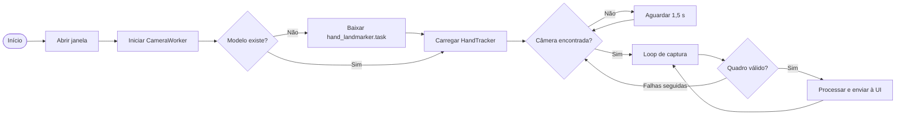
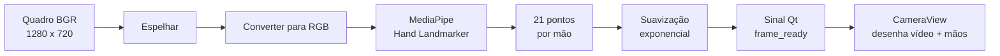
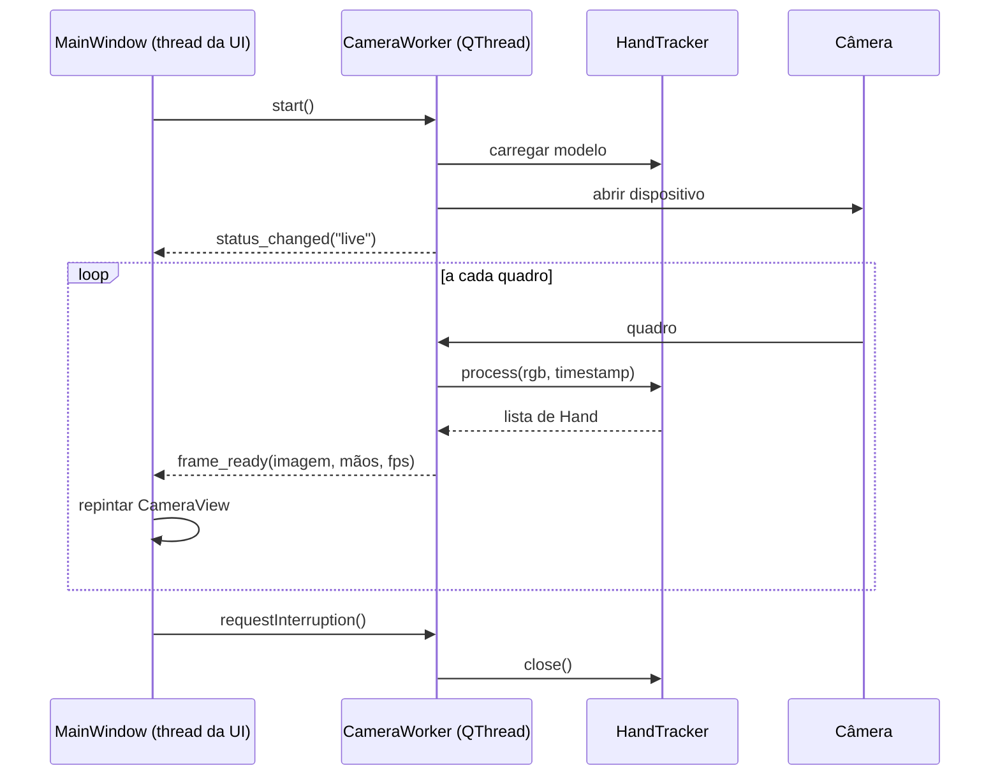
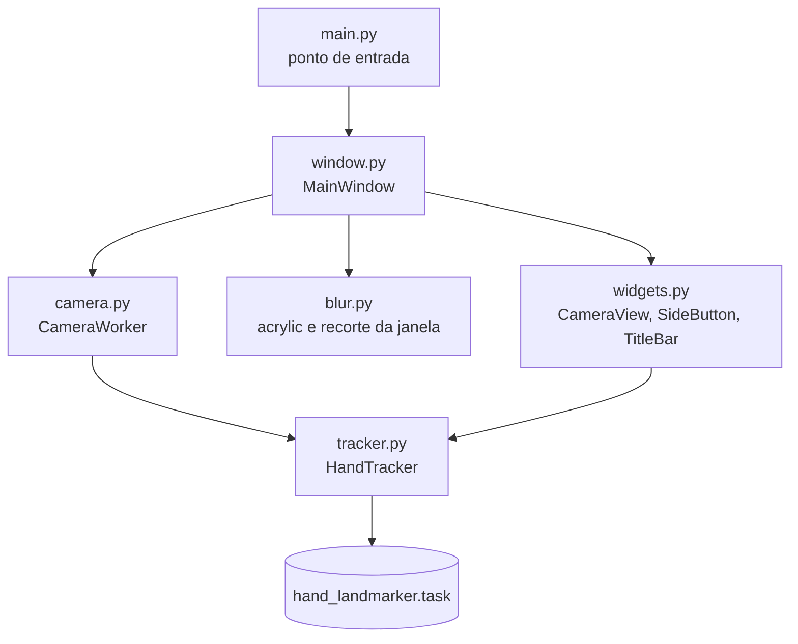
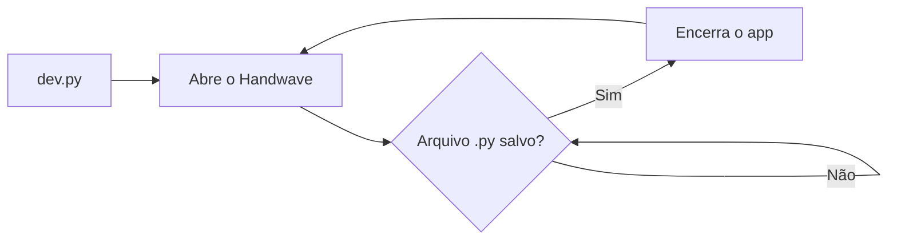
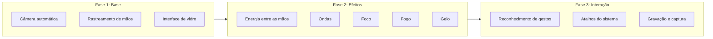

<div align="center">


# Handwave

**Controle e efeitos visuais em tempo real a partir do movimento das suas mãos.**

Uma aplicação desktop em Python que conecta a câmera automaticamente, rastreia as mãos com visão computacional e desenha tudo dentro de uma interface de vidro inspirada no macOS.

<br>


</div>

---

## Sumário

- [Visão geral](#visão-geral)
- [Recursos](#recursos)
- [Como funciona](#como-funciona)
- [Arquitetura](#arquitetura)
- [Instalação](#instalação)
- [Uso](#uso)
- [Estrutura do projeto](#estrutura-do-projeto)
- [Design](#design)
- [Roadmap e ideias](#roadmap-e-ideias)

---

## Visão geral

O Handwave transforma a webcam em uma superfície de interação. Assim que o app abre, ele procura uma câmera disponível, inicia o rastreamento e desenha o esqueleto de cada mão por cima do vídeo, com 21 pontos por mão. Isso serve de base para efeitos visuais e, mais à frente, para controle por gestos.

| | Destaque | Detalhe |
|:-:|---|---|
|  | Câmera automática | Testa os dispositivos disponíveis e reconecta sozinho se a câmera cair |
|  | Rastreamento de mãos | Até duas mãos ao mesmo tempo, com suavização para reduzir tremidas |
|  | Interface de vidro | Desfoque acrylic nativo do Windows, cantos arredondados e brilho azul |
|  | Tempo real | Captura e inferência rodam fora da thread da interface, a 30 fps |

---

## Recursos

- **Conexão automática** com a primeira câmera que responder, sem configuração
- **Reconexão** quando a câmera é desconectada ou para de enviar quadros
- **Rastreamento de 21 pontos** por mão usando o MediaPipe Hand Landmarker
- **Imagem espelhada**, para que o movimento na tela acompanhe o seu
- **Esqueleto com brilho** desenhado em vetor, nítido em qualquer resolução
- **Barra lateral de modos** pronta para receber os efeitos visuais
- **Janela sem moldura** com arrastar, redimensionar pelas bordas e maximizar
- **Download automático do modelo** na primeira execução

---

## Como funciona

### Fluxo principal



### Pipeline de cada quadro



### Comunicação entre threads



---

## Arquitetura



| Módulo | Responsabilidade |
|---|---|
| `main.py` | Cria a aplicação Qt, define fonte, ícone e abre a janela |
| `window.py` | Janela principal, barra lateral de modos, redimensionamento e ciclo de vida da câmera |
| `widgets.py` | Componentes visuais: vídeo com esqueleto das mãos, botões e barra de título |
| `camera.py` | Thread que encontra a câmera, captura quadros e chama o rastreador |
| `tracker.py` | Envolve o MediaPipe, baixa o modelo e suaviza os pontos |
| `blur.py` | Chamadas nativas do Windows para o desfoque e os cantos arredondados |

---

## Instalação

**Requisitos:** Python 3.10 ou superior e uma webcam.

```bash
git clone https://github.com/<seu-usuario>/Handwave.git
cd Handwave

python -m venv .venv
```

Ative o ambiente virtual:

```bash
# Windows
.venv\Scripts\activate

# macOS e Linux
source .venv/bin/activate
```

Instale as dependências:

```bash
pip install -r requirements.txt
```

---

## Uso

```bash
python main.py
```

Na primeira execução o modelo de mãos (cerca de 7 MB) é baixado para a raiz do projeto. Depois disso o app abre direto.

### Modo de desenvolvimento

```bash
python dev.py
```

Mantém o app aberto e reinicia automaticamente sempre que um arquivo `.py` do projeto é salvo.



| Ação | Como fazer |
|---|---|
| Mover a janela | Arraste pela faixa superior |
| Redimensionar | Arraste qualquer borda |
| Maximizar | Botão no canto superior direito ou duplo clique na faixa superior |
| Trocar de modo | Clique nos botões da barra lateral |

---

## Estrutura do projeto

```
Handwave/
├── main.py              Ponto de entrada
├── dev.py               Recarregamento automático
├── window.py            Janela principal
├── widgets.py           Componentes visuais
├── camera.py            Captura em thread separada
├── tracker.py           Rastreamento de mãos
├── blur.py              Efeito de vidro no Windows
├── logo.png             Identidade visual
└── requirements.txt     Dependências
```

---

## Design

A interface segue a linguagem de vidro do macOS, adaptada a um tema escuro e azulado.

| Elemento | Escolha |
|---|---|
| Fundo da janela | Acrylic nativo com tinta azul translúcida e borda clara de 1 px |
| Cantos | Raio de 26 px na janela e 20 px na área da câmera |
| Cor de destaque | `#4078FF` |
| Botões laterais | Círculos de vidro, com o modo ativo preenchido em azul e com brilho |
| Mãos | Linhas finas azul claro com halo, pontos brancos e pontas dos dedos maiores |
| Tipografia | SF Pro no macOS e Segoe UI Variable no Windows |

---

## Roadmap e ideias



- [x] Conexão automática com a câmera
- [x] Rastreamento de até duas mãos
- [x] Interface de vidro com barra lateral de modos
- [ ] **Energia:** partículas e um núcleo de luz que se formam entre as duas mãos e reagem à distância entre elas
- [ ] **Ondas:** rastros suaves que seguem as pontas dos dedos
- [ ] **Foco:** um anel que acompanha a pinça entre polegar e indicador
- [ ] **Fogo:** chamas saindo das pontas dos dedos, com intensidade pela velocidade da mão
- [ ] **Gelo:** cristais que crescem a partir da palma aberta
- [ ] Reconhecimento de gestos: pinça, punho fechado, mão aberta e apontar
- [ ] Controle do sistema por gestos, como volume, mídia e troca de janelas
- [ ] Tela de configurações: câmera, sensibilidade e número de mãos
- [ ] Captura de tela e gravação de vídeo com os efeitos aplicados
- [ ] Blur nativo no macOS com `NSVisualEffectView`

---

<div align="center">

Feito com Python, Qt e MediaPipe.

</div>
